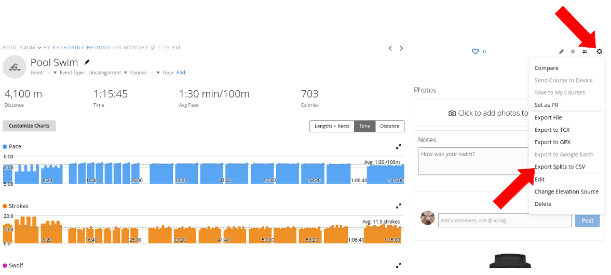
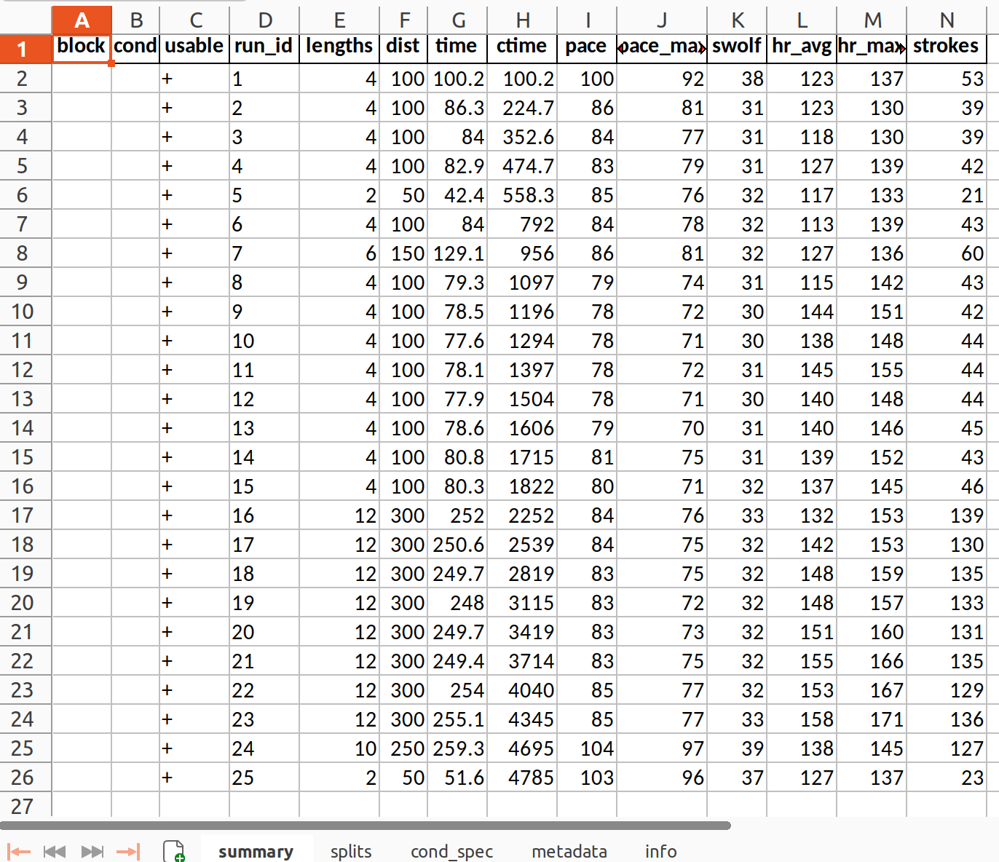
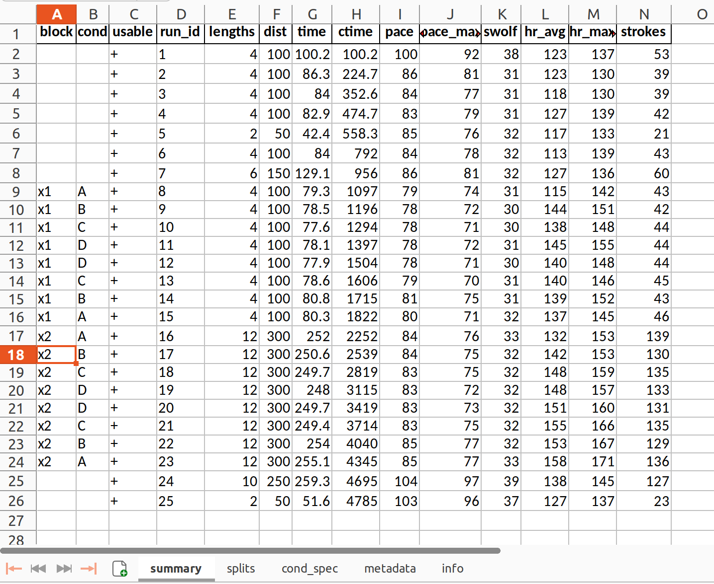
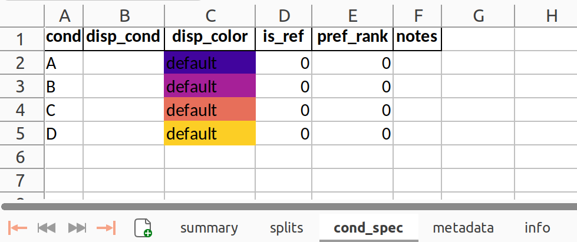
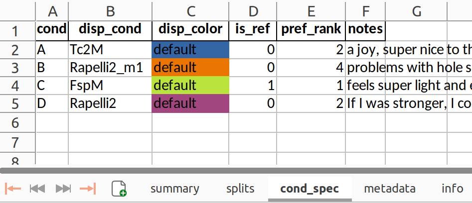
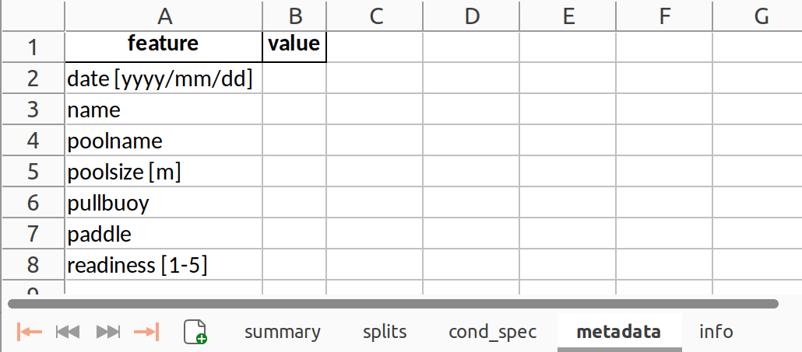
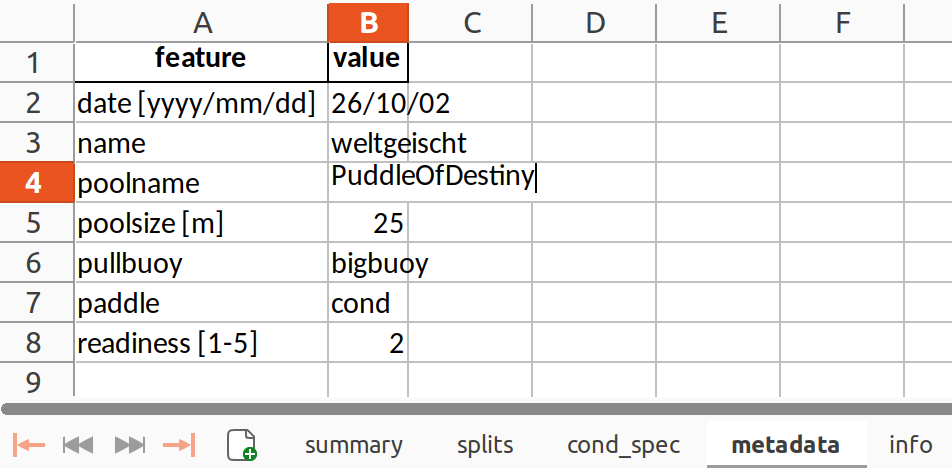

<p align="left">

</p>

# SELKIE-tools

**S**wim **E**quipment **L**over's **K**omparative **I**nterval **E**valuation tools.

Preprocess, annotate, and visualize your swim data.

Allows you to e.g. identify the toy with which you swim fastest.

## Installation

```bash

git clone https://github.com/weltgeischt/SELKIEtools.git #download from github

cd SELKIEtools #navigate to toolbox

#create virtual environment (recommended):
python -m venv .venv
source .venv/bin/activate        # Windows: .venv\Scripts\activate

#install
pip install -e . #this installs the selkie command and all dependencies
```


Set up your settings file once, if you don't want to repeat them each time:

```bash
cp SETTINGS/PATHS/general_paths.example.yml SETTINGS/PATHS/general_paths.yml 
# then edit general_paths.yml to point at your own config/output locations
```


## 1. Download your data and prepare annotation

**Export Splits to CSV:** First, export the data of a swim session from your Garmin page:



Next, **preprocess** this file with selkietools into an editable table via the `process_csv` command.  


Through the argument `N_cond` you specify the number of conditions used,
e.g. if you tested three different paddles, you would enter `-N_cond 3`. `sesssion_id` is the 
name by which you would like to refer to this session.

```bash
selkie process_csv /path/to/my/csvexport/activity_24766304204.csv -session_id KH261002 -N_cond 4 # 4 different paddles tested here
```

This creates session_id__processed.xlsx in the folder `outdir` as
specified in `SETTINGS/PATHS/general_paths.yml` (you could also specify `outfile` directly with the command).


## 2. Annotate table to identify conditions

In the xlsx file you just created, please edit the sheets *summary*, *cond_spec*, and *metadata* as follows:


### summary

The table looks like this:  




Each row corresponds to an interval. Please mark the blocks (column `block`) 
with unique block ids and the conditions (column `cond`, resolved in sheet `cond_spec`)
with unique condition ids or letters. The unique ids can be letters or numbers, whatever you like.
Condition ids must match with the ids resolving the conditions in the table `cond_spec`, however.
If an interval in a block is not usable, please replace `+`
with `-` in the column `usable`.


Example of edited summary table:



In this example there were two blocks, as annoted in the column `block`: one I called x1 and one x2.
In each block, I used four different paddles in a pyramid setup, starting with paddle A. 
The "paddle" in this case is the conditon (column `cond`).


### cond_spec

The table looks like this:



Please enter what each condition (A,B,C,D in this case, as I specified four conditions in `process_csv`) 
means, and which condition you would like to use as a reference. 
The performances during other conditions
(e.g. paddle usage) will then be analyzed relative to the reference condition.
You can also change the colors by which the different conditions will be visualized, by changing
the background color in column `disp_color`.
The column `pref_rank` allows you to rank the equipment conditions according to preference (rank 1 is best).  

Example of edited cond_spec table:




In this example, C is the reference paddle and the performances of other paddles will be reported
relative to C, e.g. 2.2% faster with paddle B compared to reference paddle C.
Here, C, the FspM paddle, felt best (`pref_rank` 1), A and D shared second place.


### metadata

The table looks like this:




Example of edited metadata table:




## 3. Plot session data

Use the command `plot_session` with the session id as given in step 1, to visualize and compare
performances across conditions in a session.

```bash
selkie plot_session KH261002
```
This creates a folder with session visualizations. The folder is by default located
as specified in `SETTINGS/PATHS/general_paths.yml` 

[Here](SESSION_VIS.md) you find examples of figures generated by the
`plot_session` command.


## 4. Compare performance across sessions 
 
todo


<!-- ## Commands -->

<!-- COMMANDS:START -->
<!-- COMMANDS:END -->

<!--## Config files -->

<!-- CONFIGS:START -->
<!-- CONFIGS:END -->


## Getting help

Details on what the script does, what options are available, and how to enter things?

```bash
selkie <command> -h   
```


## Developer TODO

- [ ] Make database with paddles, subjects, sessions?
- [ ] Design multi-session/user evaluation