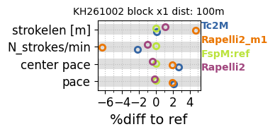
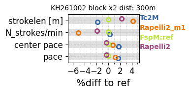
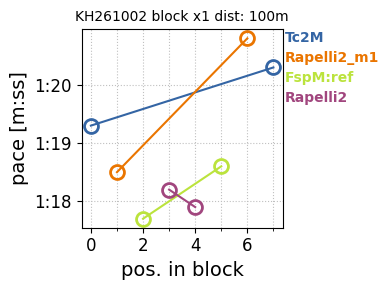
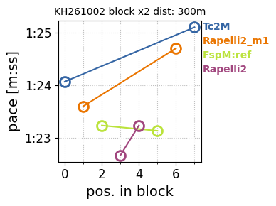
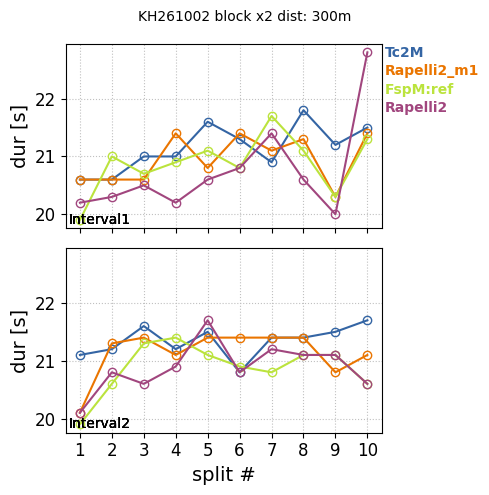
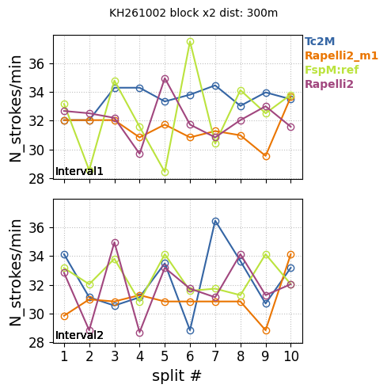
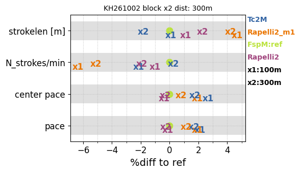
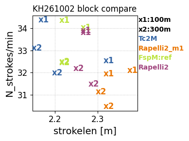

# plot_session output 

Here are a few examples of per-session visualizations as generated by the `plot_session` command.

### Summary per block

Which paddle is fastest?  
With which do I have the highest stroke rate / longest strokes?   
...??  

**N.B.:** `centerpace` is the pace calculated by excluding the first and last interval (to avoid button-press irregularities etc.).

100 m block  

300 m block  

### Pace and other metrics vs interval number

Does any condition appear to be faster?  
Did you manage to hold a similar pace over the block?

**N.B.:** starting to count from 0.

100 m block  

300 m block  

### Splits per lane

Getting faster or slower during an interval?

**N.B.:** Display excludes the first (=0) and last split, as scales get distorted by Garmin registering the first
interval as very slow and the last as very fast.

Moving arms progressively faster/slower?  

### Comparing blocks

Different strategies during shorter vs longer intvervals?

